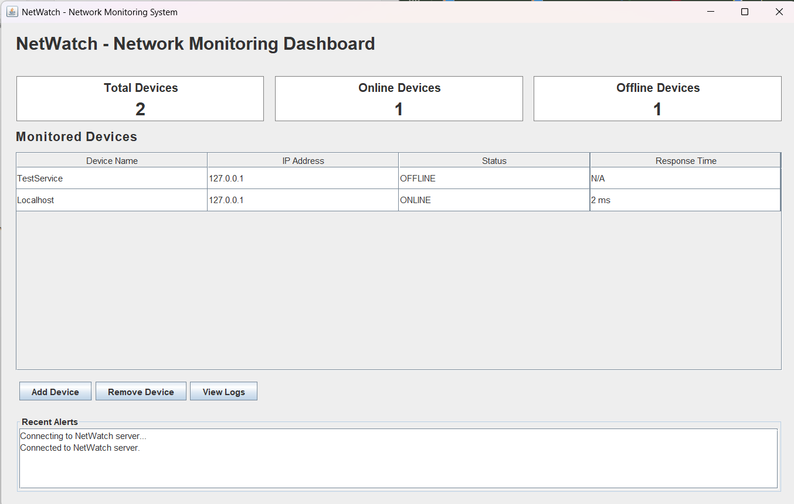
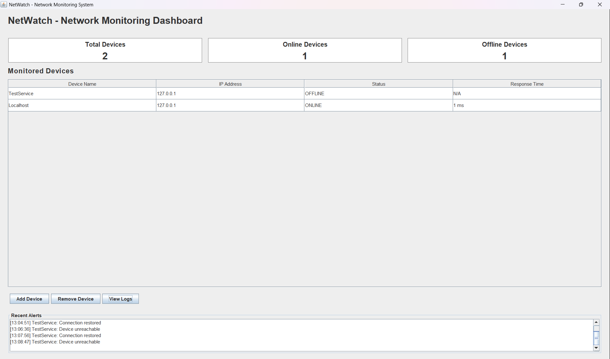
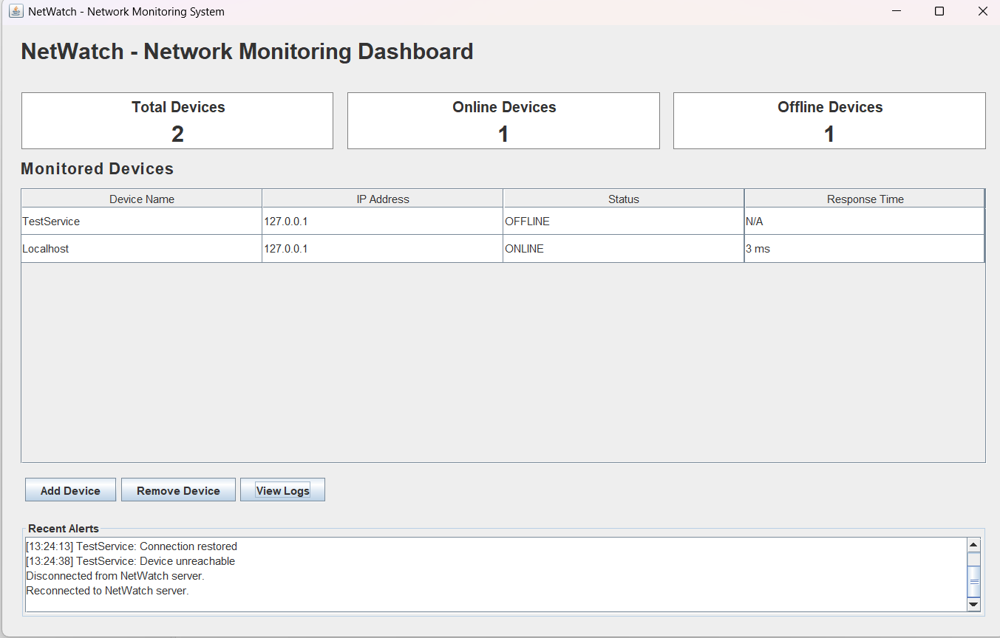
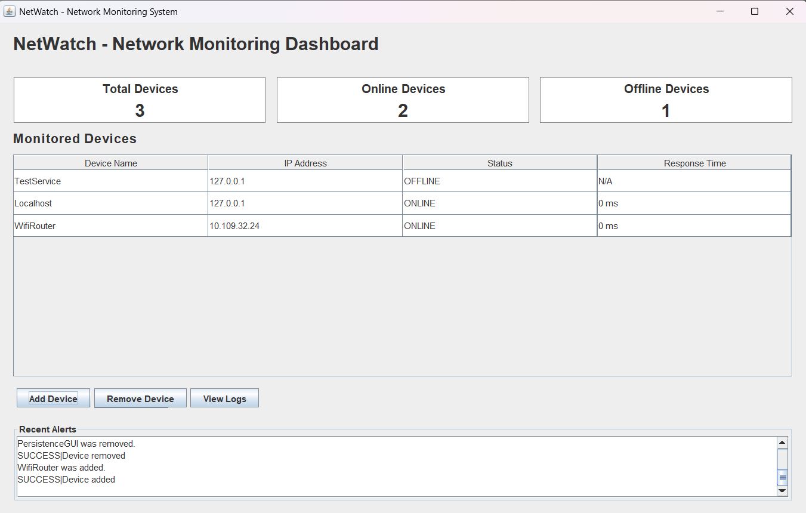
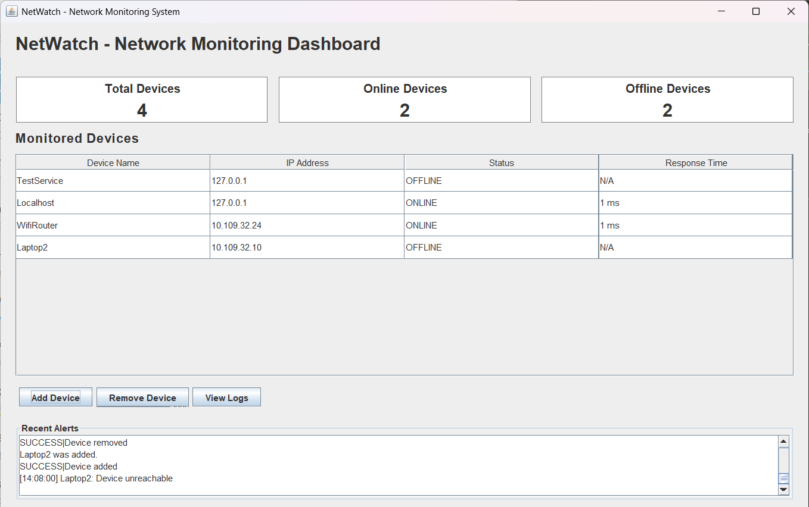

# NetWatch – Test Results

## 1. Introduction

NetWatch is a Java-based network monitoring system developed to monitor network devices, detect online and offline status changes, generate alerts, and maintain monitoring logs.

This document presents functional testing results using localhost, a local TCP service, and a second physical laptop connected through a mobile hotspot.

## 2. Test Environment

| Component | Description |
|---|---|
| Application | NetWatch – Network Monitoring System |
| Programming Language | Java |
| Development Environment | Eclipse IDE |
| Operating System | Windows |
| Server Communication | TCP, port 5000 |
| Device Monitoring | Host reachability and TCP port checks |
| Test TCP Service | Port 6000 |
| Network | Local network / Mobile hotspot |
| Main Laptop | 10.109.32.24 |
| Second Laptop | 10.109.32.10 |
| Hotspot Gateway | 10.109.32.250 |

*IP addresses reflect the test environment and may change.*

## 3. Functional Test Results

| Test ID | Test Case | Expected Result | Actual Result | Status |
|---|---|---|---|---|
| TC01 | View system logs | Monitoring events and alerts appear in Log Viewer | Logs displayed, including device events, status changes, alerts and recovery | PASS |
| TC02 | Device recovery detection | Recovery alert generated when service becomes reachable | TestService connection-restored alert displayed | PASS |
| TC03 | Device offline detection | Offline alert generated when service becomes unreachable | TestService changed to OFFLINE with unreachable alert | PASS |
| TC04 | Automatic server reconnection | Client reconnects after server restart without GUI restart | Disconnection and reconnection messages displayed | PASS |
| TC05 | Device persistence | Devices remain registered after server restart | Test device persisted and could be removed through GUI | PASS |
| TC06 | Local network host monitoring | Reachable network host detected | Configured network host appeared ONLINE | PASS |
| TC07 | Second laptop online detection | Available TCP service on another laptop detected | Laptop2 (10.109.32.10:6000) ONLINE, displayed 122 ms | PASS |
| TC08 | Second laptop offline detection | Loss of TCP service detected and alert generated | Laptop2 OFFLINE, counters updated, unreachable alert displayed | PASS |

## 4. Detailed Test Evidence

### TC01 – View System Logs

**Procedure:** Start server and client; generate monitoring events; click **View Logs**; inspect entries.

**Observed:** Monitoring events and system logs displayed successfully. **Status: PASS**

### TC02 – Device Recovery Detection

**Procedure:** Monitor TestService; stop it; restart it; observe dashboard.

**Observed:** Connection-restored alert displayed. **Status: PASS**

### TC03 – Device Offline Detection

**Procedure:** Start TestService on port 6000; verify ONLINE; stop it; wait for monitoring update.

**Observed:** Device changed to OFFLINE and unreachable alert appeared. **Status: PASS**

### TC04 – Automatic Server Reconnection

**Procedure:** Start server and GUI; terminate server while GUI remains open; restart server; observe messages.

**Observed:** Disconnection and reconnection notifications displayed without restarting GUI. **Status: PASS**

### TC05 – Device Persistence

**Procedure:** Add test device via dashboard; restart server; verify device remains; remove device.

**Observed:** Device persisted across restart and could be removed. **Status: PASS**

*Add screenshot evidence if available.*

### TC06 – Local Network Host Monitoring

**Procedure:** Connect to network; add reachable host address; wait for status update.

**Observed:** Configured host appeared ONLINE. **Status: PASS**

### TC07 – Second Laptop ONLINE

**Procedure:** Connect both laptops to same hotspot; start TCP listener on Laptop2 port 6000; confirm `Test-NetConnection 10.109.32.10 -Port 6000`; register Laptop2 in NetWatch.

**Observed:** TCP connection succeeded; Laptop2 ONLINE with displayed 122 ms; 4 devices total, 3 online, 1 offline. **Status: PASS**

### TC08 – Second Laptop OFFLINE

**Procedure:** Stop TCP listener on Laptop2; wait for monitoring update; inspect dashboard and alerts.

**Observed:** Laptop2 OFFLINE, response time N/A; 4 devices total, 2 online, 2 offline; alert `[14:08:00] Laptop2: Device unreachable`. **Status: PASS**

## 5. Additional Network Testing Observations

Both laptops were on the same mobile hotspot. ICMP ping between laptops timed out, although both could reach the gateway. A direct TCP connection from the main laptop to Laptop2 on port 6000 succeeded. TCP-based monitoring therefore worked despite unavailable ping responses.

## 6. Test Summary

| Metric | Result |
|---|---|
| Total Functional Test Cases | 8 |
| Passed | 8 |
| Failed | 0 |
| Functional Test Pass Rate | 100% |

All eight documented functional tests passed in the tested environment. This is not exhaustive security, performance or reliability testing.

## 7. Conclusion

NetWatch successfully monitored local and remote TCP services, detected availability changes, generated alerts, displayed logs, retained devices after server restarts, and reconnected the client after server interruption. The second-laptop test demonstrated TCP-based monitoring across two physical computers on the same hotspot.
